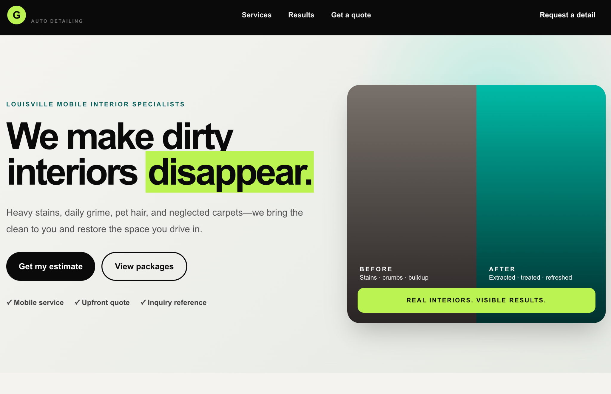
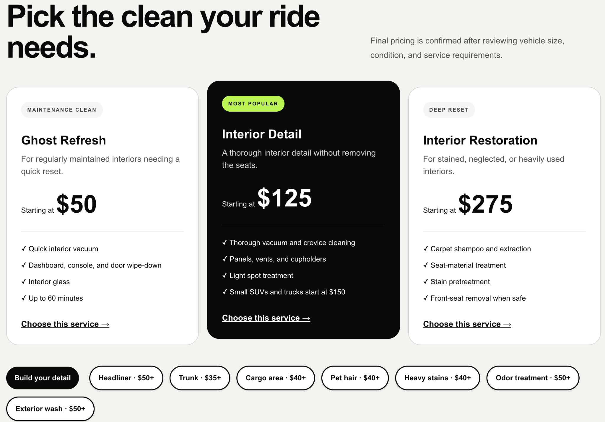
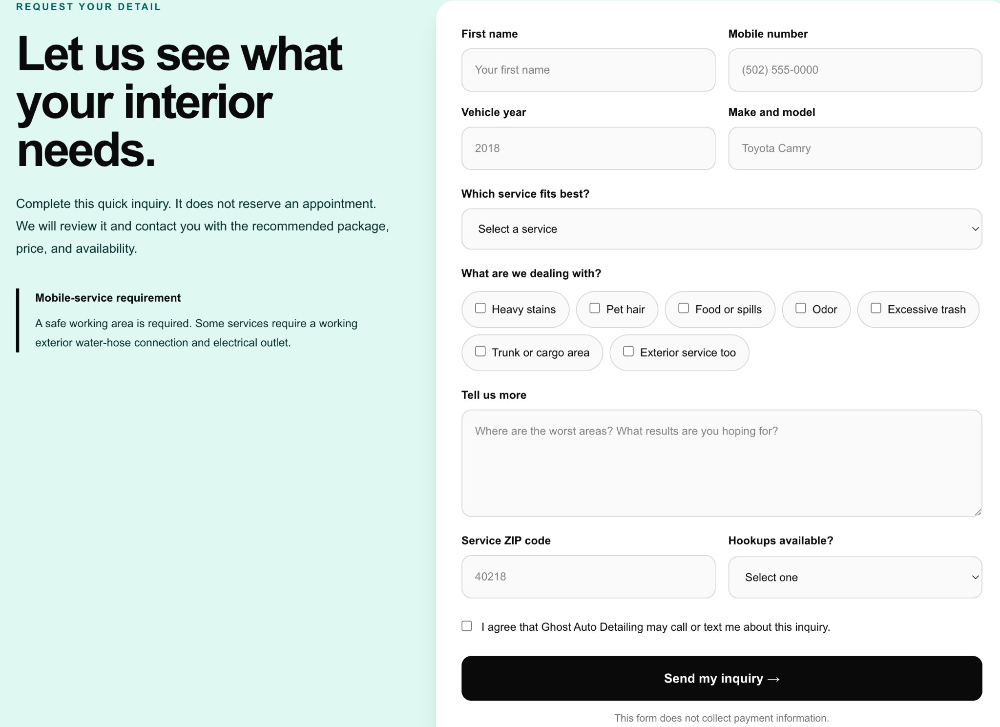
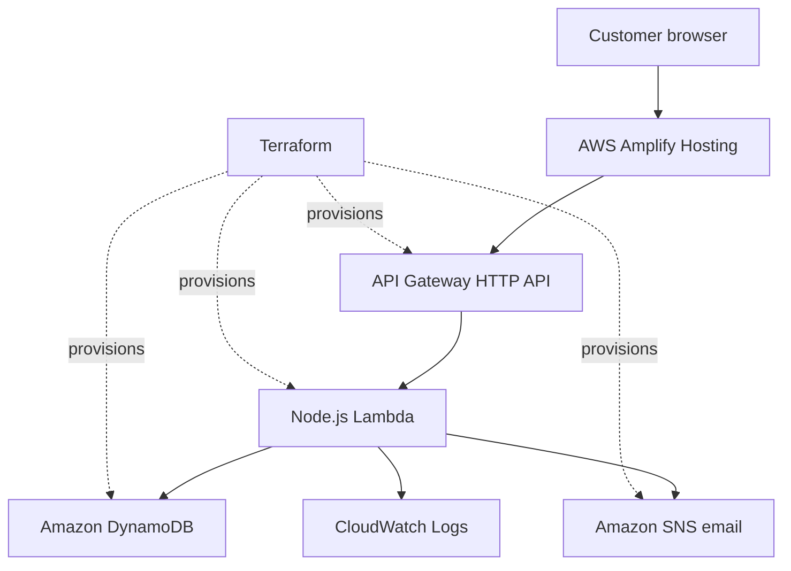

# Ghost Auto Detailing

A production-deployed customer inquiry platform for a mobile auto-detailing business serving Louisville, Kentucky, and surrounding areas.

[View the live application](https://main.d2k6n4jnju5mq7.amplifyapp.com)



## Overview

Ghost Auto Detailing turns an informal quote-request process into a structured serverless workflow. Customers can compare detailing packages, select a service, describe their vehicle’s condition, and submit an inquiry through a responsive website.

Each successful inquiry receives a unique reference number. The complete inquiry is stored in Amazon DynamoDB, and the business owner receives an email notification through Amazon SNS.

## Features

- Responsive, mobile-first service website
- Detailing packages, starting prices, and add-ons
- Service-card links that preselect the matching form option
- Customer inquiry form with client and server validation
- Unique `GAD-2026-XXXXXXXX` inquiry reference numbers
- DynamoDB inquiry persistence
- Complete owner email notifications through Amazon SNS
- Honeypot and minimum-completion-time spam defenses
- Request-size validation
- API Gateway throttling and origin-restricted CORS
- CloudWatch Lambda logging
- Static frontend deployment with automatic GitHub-based builds

## Interface

### Service packages



### Customer inquiry experience



## Architecture



The Next.js frontend is exported as a static application and hosted by AWS Amplify. Form submissions are sent directly to an API Gateway HTTP API, which invokes a Node.js Lambda function. The Lambda validates each request, stores it in DynamoDB, publishes the owner notification, and returns the inquiry reference number.

## Technology Stack

### Frontend

- Next.js 16
- React 19
- TypeScript
- Tailwind CSS 4
- Static export
- AWS Amplify Hosting

### Backend

- Amazon API Gateway HTTP API
- AWS Lambda with Node.js 22
- Amazon DynamoDB
- Amazon SNS
- Amazon CloudWatch
- Zod validation

### Infrastructure and Delivery

- Terraform
- Amazon S3 remote Terraform state
- Git and GitHub
- AWS Amplify continuous deployment
- esbuild
- ESLint

## Security and Reliability

The application collects only the information needed to review and respond to a detailing inquiry. It does not collect payment-card numbers, bank information, passwords, or customer accounts.

Implemented protections include:

- Server-side schema validation with Zod
- Maximum request-body size
- Honeypot spam detection
- Minimum form-completion time
- API Gateway request throttling
- Explicit browser-origin allowlist
- Least-privilege Lambda permissions
- Encrypted AWS-managed data services
- Conditional DynamoDB writes
- CloudWatch error logging without logging full customer submissions
- Environment variables excluded from Git

The public API address is configuration, not a secret. AWS credentials, Terraform state, notification addresses, and local environment files must never be committed.

## Local Development

### Requirements

- Node.js
- npm
- Git

Install the exact dependencies recorded in the lock file:

```bash
npm ci
```

Create a local environment file from the example:

```bash
cp .env.example .env.local
```

Set the inquiry API endpoint in `.env.local`:

```text
NEXT_PUBLIC_INQUIRIES_API_URL=https://your-api-id.execute-api.us-east-1.amazonaws.com/inquiries
```

Start the development server:

```bash
npm run dev
```

Open:

```text
http://localhost:3000
```

The current frontend submits to the configured AWS API, so a local database container is not required for ordinary interface development.

## Quality Checks

Run the frontend linter:

```bash
npm run lint
```

Build the Lambda bundle:

```bash
npm run build:lambda
```

Build the production frontend:

```bash
npm run build
```

Check production dependencies:

```bash
npm audit --omit=dev
```

Validate the Terraform configuration:

```bash
terraform fmt -check -recursive infra/terraform
terraform -chdir=infra/terraform validate
```

## Deployment

Pushes to the `main` branch trigger an AWS Amplify build and frontend deployment.

The backend infrastructure is managed separately with Terraform:

```bash
terraform -chdir=infra/terraform init
terraform -chdir=infra/terraform plan
terraform -chdir=infra/terraform apply
```

Terraform changes should always be reviewed before applying. AWS credentials and required Terraform variables must be supplied through the local environment rather than committed files.

## Environment Variables

| Variable                          | Used by          | Purpose                           |
| --------------------------------- | ---------------- | --------------------------------- |
| `NEXT_PUBLIC_INQUIRIES_API_URL`   | Next.js frontend | Public inquiry API endpoint       |
| `DYNAMODB_INQUIRIES_TABLE`        | Lambda           | DynamoDB table name               |
| `SNS_TOPIC_ARN`                   | Lambda           | Owner-notification SNS topic      |
| `AWS_REGION`                      | Lambda/AWS SDK   | AWS deployment region             |
| `TF_VAR_owner_notification_email` | Terraform        | Notification subscription address |

Lambda environment values are configured by Terraform. The Amplify frontend variable is configured through the Amplify application settings.

## Project Status

The production inquiry workflow is live and verified end to end:

```text
Amplify website
    → API Gateway
    → Lambda validation
    → DynamoDB storage
    → SNS owner notification
    → Customer reference number
```

Verified behaviors include service selection, browser submission, server validation, inquiry storage, complete notification emails, and customer-facing success responses.

## Roadmap

Potential future enhancements include:

- Before-and-after customer gallery
- Secure photograph uploads
- Internal inquiry-status dashboard
- Appointment scheduling
- Hosted invoices and digital receipts
- Verified customer reviews
- Custom production domain

## Author

Built by **CUE Cyber Cafe** as a production AWS serverless portfolio project.
